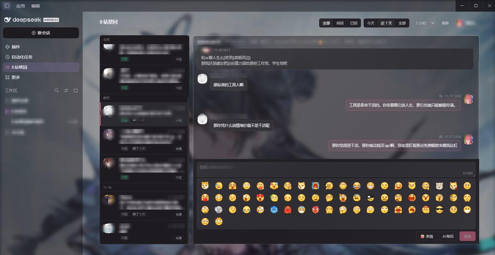

# dsh-bili-banghui · B站帮回

> **声明**：非官方插件，与哔哩哔哩（B站）无隶属关系。
> 所有凭证、人设、流水、语料只保存在本机 `data\` 目录，插件不上传任何数据；API Key 也只在本机使用。

B站 消息一多就乱：谁回了你哪句、你回过谁、哪句还欠着。这个插件把「回复我的」收进 DSH 左侧栏，每个人的每个楼层攒成一条会话，右边就看 主楼 → 他 → 你 这一段，不用来回翻评论区找上下文。想不出怎么接，点一下「AI帮回」：它先看对方是夸你、跟你瞎聊，还是在挑刺，再给三条，你挑一条改成自己的口气，确认了才发出去。




## 第一次用：三步

三样东西都在**面板右上角**：没登录时是一个「登录」按钮，登录后点头像出菜单。

1. **登录 B站**
   点「登录」出二维码，用手机 B站 扫一下并确认。凭证存在本机；过期了点头像 →「重新扫码登录」再扫一次。
2. **填一个模型 Key**
   头像 →「API Key」，粘贴 `sk-` 开头的 key，保存后立刻生效。只有「AI帮回」用得上它；不填也能自己写、照常发送。
3. **写下你自己的口气**
   头像 →「人设档案」，说说你平时怎么讲话、什么立场、爱用哪些词。写得越像你，它给的三条越像你自己说的。发过几条之后，也可以点「从样本归纳」，让它读读你最近说过的话，帮你补一段。

## 日常怎么用

1. 左边按最新回复倒序，点一个人，右边就是他的评论、你之前那句，还有你们的来回
2. 点「AI帮回」→ 上面先写明白对方现在是什么态度（赞同 / 友善 / 中立 / 抬杠 / 攻击），下面是三条：
   **A 主选 · B 变体 · C 收尾**。碰上赞同和友善的，三条都不会跟你抬杠，只换语气
3. 点一条直接进输入框，随便改；不满意就点那条右上角的「换一个」
4. 点「发送」→ 再确认一次 → 发出去；这条会马上变「已回」，流水也记好了
5. 不想搭理的人点「不回」，列表里就不会再提醒你

## 它做了什么

- 列表：按人×楼层聚在一起，最新回复排最前，今天/昨天/更早分组；也能只看今天、近 7 天或全部
- 状态：未回 / 已回 / 不回（已回是插件自己发的才认，手动去网页回的不算）
- 对话：主楼（作者头像和时间）→ 他 → 你，旁人插话自动折起来
- 顶栏：当前视频的 BV 号和标题，同一个视频不重复拉
- **AI帮回**：先说清对方什么态度，再按态度给三条，每条都能「换一个」
- 发送：二次确认后才发；同一条 30 秒内、全局 5 秒内不会重复发
- 轮询：10 分钟到 8 小时可选，默认关着；有新回复右下角冒个小通知，点一下跳工作台
- 表情：B站 常用表情内置了一份，点图就能插入 `[doge]` 这种代码
- 头像菜单：人设档案 / API Key / 重新扫码登录

## 目录（全部在这一个文件夹里）

```
dsh-bili-banghui\
  index.js            宿主：HTTP 路由、登录、人设读写、候选生成、发送
  client.js           前端：页面、弹窗、通知浮层
  lib\workbench.js    数据层：msgfeed、楼层翻页、视频信息、缓存
  cordis.patch.yml    挂载声明（只挂 UI）
  package.json        版本/清单
  icon.svg            本地插件页图标
  locale\zh.json      插件名与简介
  locale\en.json
  assets\emotes\      内置表情图 + emotes.json
  data\               ← 个人数据，不进 git、不发包
    credential.json     B站 凭证
    persona.md          人设档案
    reply-log.md        发送流水
    samples.jsonl       语料（发送时自动追加）
    apikey.txt          模型 Key
    muted.json          不回名单
```

数据目录默认就是 `data\`，可以用 patch 里的 `credFile / personaFile / keyFile` 指到别处。

## 配置

`cordis.patch.yml` 的 `config` 只留 `apiBase` / `model`，路径默认走 `data\`；页面里也能改 Key 和人设。

## 开发

- 只改 `client.js` → 窗口 `Ctrl+R`
- 改 `index.js` / `lib/*` → 重启 DSH
- link 安装，改完不用重装；git 仓库就在插件目录里，随时能回滚

## MCP 可选

列表、对话、发送都是直连 B站 接口，**不依赖 MCP**。只有想在对话里用 `bili_*` 工具时才需要挂 MCP server。

## 限制

- 「已回」只认插件自己的流水，在手机或网页上手动回过的，它看不出来
- B站 楼中楼只有两层，这里是按回复关系还原的
- 楼层按页拉，最多 20 页 / 400 条；特别长的楼层只能看到最新一段，但要回的那条一定会显示
