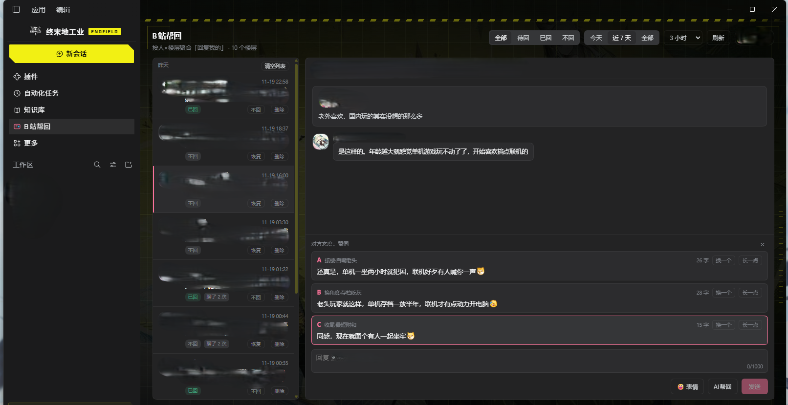

# dsh-bili-banghui · B站帮回

> **声明**：非官方插件，与哔哩哔哩（B站）无隶属关系。
> 所有凭证、人设、流水、语料只保存在本机 `data\` 目录，插件不上传任何数据；API Key 也只在本机使用。

还在为回 B站 的傻福消息而苦恼吗？这个插件 AI 帮你回消息，把「回复我的」按人与楼层聚合成会话，右侧把 主楼 → 他 → 你 拉成一条线，不用再翻评论区找上下文；点「AI帮回」，它先看对方是夸你、跟你聊还是在挑刺（赞同/友善就不跟你抬杠），再给三条候选，你挑一条改成自己的口气，确认了才发出去，发完自动记一笔。登录、人设、API Key 都在面板右上角的头像菜单里，凭证只存在本地 data 目录。



## 第一次用：三步

三样东西都在**面板右上角**：没登录时是一个「登录」按钮，登录后点头像出菜单。

1. **登录 B站**
   点「登录」出二维码，用手机 B站 扫一下并确认。凭证存在本机；过期了点头像 →「重新扫码登录」再扫一次。
2. **填一个模型 Key**
   头像 →「API Key」，粘贴 `sk-` 开头的 key，保存后立刻生效。只有「AI帮回」用得上它；不填也能自己写、照常发送。
3. **写下你自己的口气**
   头像 →「人设档案」，说说你平时怎么讲话、什么立场、爱用哪些词。写得越像你，它给的三条越像你自己说的。发过几条之后，也可以点「从回复总结语料」，它只总结上次之后的新语料，总结过的不会重复算。

## 人设档案怎么写

不写也能用，只是 AI 不知道你的口气。怎么写都行：**用 `## 小标题` 分段**读得最准（标题里带「维护」「来源」「隐私」的段落会被跳过），不分段就整篇读，最多读 6500 字，超了从后面截断，重要的往前放。

不知道从哪下手，就点头像 →「人设档案」→「插入模板」，模板只供参考，不满意直接改。大致长这样：

```markdown
## 我是谁
- 上班族；自嘲老头、牢玩家
- 用户心态：愿意为喜欢的东西掏钱，讨厌玩盗版还理直气壮跳脸的
- 玩二游和单机，也看科技、数码、时政；说话是论坛/评论区那一代的口吻
- 对「不合理，不理性，不唯物」不耐烦，但不会见人就怼

## 我怎么想
- 论点先站得住：讲事实、讲逻辑、讲成本，谁主张谁举证；站不住就认
- 唯物主义：先看钱是谁出的、算力是谁买的、时间是谁花的，不从口号倒推结论
- 合理批判：有对象、有依据、点到为止，不拿身份和情绪当论据
- 合理怀疑：怀疑要给理由，对方讲清楚就不追究，不为赢而赢
- 说完就停，不追求说服

## 我怎么说话
- 默认 15–35 字，一两句说完；讲理才到 60–100 字
- 结尾多是判断句；反问是偶尔一刀，不是每句都来
- 尾字：吧、呢、啊、嘛、呗；口头禅：其实、确实、说白了、就这么简单
- 起句常用「我看了 / 我试了 / 我刚才… / 有一说一 / 确实 / 懂得都懂」
- 表情 1–3 个，爱连发两个同款
- 不满会直接点名：这点不好、这也太尴尬了、这个太 AI 了

## 我怎么回
1. 复述归谬：把对方的诉求翻成「既要又要」
2. 指出偷换：对方替我加的观点，明确不认
3. 给现实方案：花钱买 API / 去医院 / 自己去了解
4. 拆逻辑分点：对方讲商业、讲机制时才用
5. 一句反问收尾：少用
6. 不接第二轮：说完就停

## 别学我什么
- 不学打错字，不带家属，不带地域，不主动引战
```

弹窗顶上就三句话说明用法，不再显示文件路径和语料条数。

## 日常怎么用

1. **挑人**：左边按最新回复倒序，点一个人，右边就是主楼 → 他 → 你，你在站内回过的也会补进来
2. **AI帮回**：点一下，先显示对方态度（赞同 / 友善 / 中立 / 抬杠 / 攻击 / 罕见发言），再给三条：
   **A 主选 · B 变体 · C 收尾**；判成罕见发言时，三条换成嘲讽 / 反问 / 挖苦三个角度。
   每条都能「换一个」，也能「长一点」写长
3. **改**：点一条填进输入框，随便改；输入框会随内容自动长高
4. **发**：点「发送」→ 再确认一次；发失败正文还在，可以「重试」；对方把你拉黑时会问你要不要标记不回
5. **收拾**：不想回的点「不回」，进单独的「不回」栏；不想留的对话点行里的「删除」；
   列表右上角「清空列表」一次清掉全部；头像菜单里还能设「自动清理旧对话」（30–180 天没新回复就不显示）

## 它做了什么

- 列表：按人×楼层聚在一起，最新回复排最前，今天/昨天/更早分组；也能只看今天、近 7 天或全部
- 状态：未回 / 已回 / 不回，三个筛选栏分开（已回 = 插件发过的，或楼层里你最后回过）
- 对话：主楼（作者头像和时间）→ 他 → 你，旁人插话自动折起来；你回主楼的那条也会补进来
- 顶栏：当前视频的 BV 号和标题，同一个视频不重复拉
- **AI帮回**：先说清对方什么态度，再按态度给三条；「换一个」换说法，「长一点」写长
- 发送：二次确认后才发；同一条 30 秒内、全局 5 秒内不会重复发；失败可重试
- 轮询：10 分钟到 8 小时可选，默认关着；有新回复右下角冒个小通知，点一下直接跳到那个人
- 表情：内置 B站 常用表情，点图插入 `[doge]` 这种代码，正文里直接显示成表情图
- 头像菜单：人设档案 / API Key（模型和接口也能改）/ 自动清理旧对话 / 重新扫码登录
- 删除对话：行里的「删除」只从列表里删掉（本地记录），B站 评论不动；对方之后再回，会重新出现
- 清空列表：列表右上角，一次把当前全部对话隐藏（不只看今天，也不管筛选）
- 被拉黑时：发送失败会弹确认，可只标记「不回」，或顺手把对方加入 B站 黑名单并删掉这个对话
- 导出人设：人设档案里点「导出人设」，存成 `persona.md`，换电脑或备份用

## 目录（全部在这一个文件夹里）

```
dsh-bili-banghui\
  index.js            宿主：HTTP 路由、登录、人设读写、候选生成、发送
  client.js           前端：页面、弹窗、通知浮层
  lib\workbench.js    数据层：msgfeed、楼层翻页、视频信息、缓存
  cordis.patch.yml    挂载声明（只挂 UI）
  package.json        版本/清单
  icon.svg            本地插件页图标
  locale\zh.json      插件名与简介
  locale\en.json
  assets\emotes\      内置表情图 + emotes.json
  data\               ← 个人数据，不进 git、不发包
    credential.json     B站 凭证
    persona.md          人设档案
    reply-log.md        发送流水
    samples.jsonl       语料（发送时自动追加）
    apikey.txt          模型 Key
    muted.json          不回名单
```

数据目录默认就是 `data\`，可以用 patch 里的 `credFile / personaFile / keyFile` 指到别处。

## 配置

模型和接口地址可以直接在头像 →「API Key」里改（存 `data\settings.json`，优先于 `cordis.patch.yml` 的 config）；Key、人设也都在页面里改，路径默认走 `data\`。

## 开发

- 只改 `client.js` → 窗口 `Ctrl+R`
- 改 `index.js` / `lib/*` → 重启 DSH
- link 安装，改完不用重装；git 仓库就在插件目录里，随时能回滚

## MCP 可选

列表、对话、发送都是直连 B站 接口，**不依赖 MCP**。只有想在对话里用 `bili_*` 工具时才需要挂 MCP server。

## 限制

- 「已回」看两处：插件自己发的流水，或楼层里你最后回过；如果两边都没有，就还是「未回」
- B站 楼中楼只有两层，这里是按回复关系还原的
- 楼层按页拉，最多 20 页 / 400 条；特别长的楼层只能看到最新一段，但要回的那条一定会显示
